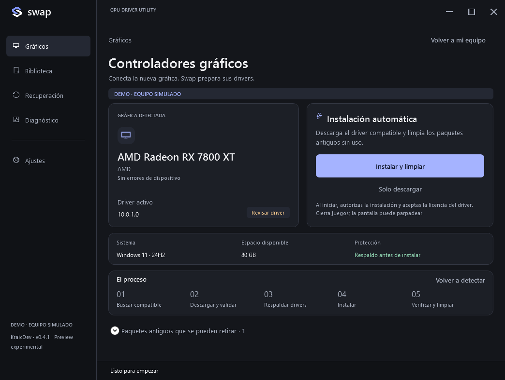
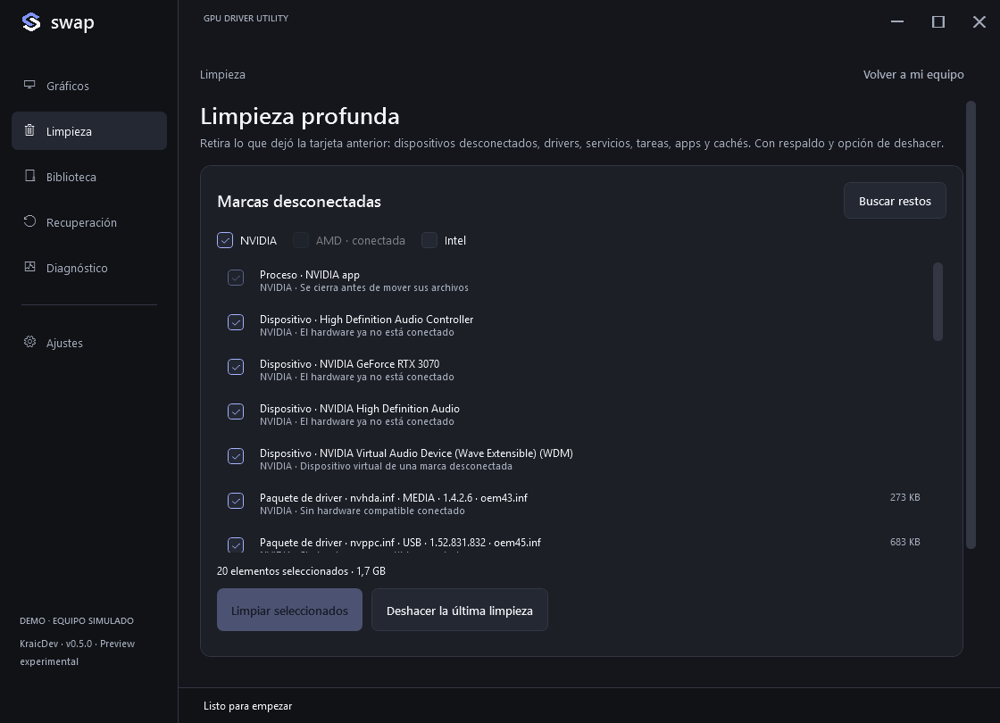

# Swap · KraicDev

**Prepara Windows después de conectar una gráfica de otra marca.** NVIDIA, AMD e Intel Arc. Instala el driver nuevo y retira lo que dejó la tarjeta anterior, con respaldo y botón de deshacer. Gratis, sin cuenta ni suscripción.

[Página](https://zkraic.github.io/Swap/) · [Descargar](https://github.com/zKraic/Swap/releases) · [English](README.md)

**Swap 1.0.** Cada EXE publicado se valida tal cual: pruebas de lógica e interfaz, un Windows aislado con paquetes de driver firmados reales, una limpieza profunda medida frente a Display Driver Uninstaller con el driver oficial de AMD y los cambios de tarjeta registrados en [Resultados](docs/validation/V100-RESULTS.md), con cada límite. La firma depende de aprobación externa. [Comparación con DDU](docs/COMPARISON-DDU.md).

Con la nueva tarjeta conectada, **Instalar y limpiar** busca un driver de pantalla compatible en Windows Update, lo descarga, respalda los paquetes actuales, instala y verifica el driver activo firmado y Direct3D en hardware. Solo después limpia la marca que ya no está conectada. Conserva GPU presentes, integradas y configuraciones híbridas.

Windows guarda la tarjeta retirada como *dispositivo desconectado* que sigue usando su paquete, y se niega a borrar ese paquete. Swap retira primero solo esa entrada desconectada de la misma marca y luego el paquete. (Hasta la 0.4.2 la limpieza se detenía aquí en un cambio real.)

## Voy a cambiar de tarjeta

Pulsa **Voy a cambiar de tarjeta** antes de apagar. Swap respalda los drivers gráficos y guarda cómo ven la tarjeta actual los juegos y las pantallas. Pulsa **Apagar el equipo** en Swap (apagado completo, para poder desconectarlo de la corriente), cambia la tarjeta y enciende: al iniciar sesión Swap se abre solo con permisos de administrador y sin aviso de UAC, reconoce la nueva, te da 20 segundos para cancelar, instala su driver, retira la marca anterior con respaldo y te entrega un **informe de validación**. Si la red aún se está conectando o Windows instala el mismo driver por su cuenta, Swap espera y reintenta hasta ocho minutos, y conserva el driver que instaló Windows una vez verificado. Contempla que la tarjeta anterior siga conectada, que no aparezca la nueva, que haya varias nuevas y que el driver pida reiniciar; nunca apaga ni reinicia sin tu confirmación.

## Limpieza profunda

La página **Limpieza** hace lo que normalmente se hace con Display Driver Uninstaller, sin modo seguro, porque la tarjeta antigua ya no está:

| Se retira con evidencia | Se conserva a propósito |
|---|---|
| Dispositivos desconectados de GPU, audio HDMI y USB-C; dispositivos virtuales de la marca | Todo lo de una marca que siga conectada |
| Paquetes de todas las clases gráficas (pantalla, audio HDMI, USB-C, extensiones) y los componentes que crean (OpenCL, componentes de soporte) | Chipset AMD (VEN_1022) y paquetes Intel de red, almacenamiento y plataforma |
| Servicios, tareas e inicios cuyo programa ya no existe o se retira | PhysX (algunos juegos lo necesitan con cualquier GPU) |
| Archivos que un driver dejó en System32/SysWOW64, registros de Vulkan/OpenCL, códecs COM y transformaciones de Media Foundation, entradas de protección PnP | Los cargadores comunes de Vulkan/OpenCL y runtimes de Microsoft; capas de Steam, OBS, RTSS, Overwolf, Epic o Rockstar |
| Paneles de la Tienda, carpetas del fabricante (a cuarentena), cachés de sombreadores, ajustes y entradas huérfanas de Programas | GPU integrada del procesador y portátiles: aparecen sin marcar |

La propiedad se decide por las instancias de dispositivo y los IDs de hardware de cada INF, no por nombres de productos. Cada elemento explica por qué se puede retirar y se puede desmarcar. Antes de cambiar algo, Swap crea un punto de restauración, exporta paquetes y registro, y mueve las carpetas a una cuarentena sellada en `%ProgramData%\Swap\Cleanup` (solo Administradores y SYSTEM). **Deshacer la última limpieza** restaura todo lo que tiene respaldo.

La misma página retira **versiones antiguas sin uso del driver actual** (a menudo varios GB) y conserva la activa y la anterior más reciente.

**Diagnóstico → Juegos** pregunta a Direct3D 12, Vulkan y OpenCL, en un proceso aparte de Swap, qué GPU ven, y avisa si Vulkan u OpenCL siguen apuntando a la marca anterior o no ven la nueva. También detecta una tarjeta con menos carriles PCIe de los que admite (ranura equivocada o mal encajada) y ofrece la frecuencia máxima del monitor, que tras un cambio suele quedar en 60 Hz, con confirmación de 15 segundos para mantener o revertir. El **informe de validación** está en inglés para un issue de GitHub y no lleva identificadores del equipo ni nombres de cuenta. **Crear respaldo** exporta los drivers gráficos sin modificarlos. [Comparación medida con DDU](docs/COMPARISON-DDU.md).

Descarga **[Swap.exe 0.6.0](https://github.com/zKraic/Swap/releases/download/v0.6.0-preview/Swap.exe)** y, si quieres, su [SHA-256](https://github.com/zKraic/Swap/releases/download/v0.6.0-preview/Swap.exe.sha256) (`CE5BF7F8…2D825CC`); [notas de la versión](https://github.com/zKraic/Swap/releases/tag/v0.6.0-preview). Ábrelo y acepta UAC. No hay instalador de Swap ni ZIP ni instalación separada de .NET. El diagnóstico no necesita reiniciar; Windows puede exigirlo después de cambiar drivers. Swap guarda la sesión y conserva lo pendiente.

Windows 10/11 x64, PowerShell 5.1, conexión y Windows Update operativo para descarga automática. 4 GB libres más el espacio del driver. No instala toda la suite del fabricante ni fuerza retiradas, modo seguro o ajustes de juegos. Bloquea cambios en RDP, durante una sesión de control remoto (TeamViewer mientras alguien está conectado; AnyDesk, RustDesk, Escritorio remoto de Chrome o Parsec siempre que se ejecuten) y mientras Windows espera un reinicio de mantenimiento; los borrados pendientes de archivos sobrantes de instaladores no cuentan. El diagnóstico y respaldo independiente siguen disponibles. Si hay varias gráficas candidatas, exige elegir la nueva.

Seis idiomas según el PC y temas claro/oscuro/sistema. Datos en `%LOCALAPPDATA%\Swap`; una carpeta `Data` escribible junto al EXE permite almacenamiento portable. Sin servicios ni tareas permanentes: un cambio de tarjeta preparado, o un cambio de driver que pide reiniciar, registra una tarea de inicio de sesión para tu cuenta (con RunOnce de respaldo, que pide UAC solo si la tarea no puede ejecutarse). Abre una copia de Swap en `%ProgramData%\Swap\Continuation` que solo los administradores pueden modificar, y Swap borra la tarea al terminar o al cancelar.

Código en `main`. [Contribuir](CONTRIBUTING.md) · [Seguridad](SECURITY.md) · [Recuperación](docs/RECOVERY.md) · [Firma](docs/SIGNING.md).

Copyright © 2026 **KraicDev** · [GPL-3.0-or-later](LICENSE). Las modificaciones distribuidas deben conservar la GPL, avisos y código correspondiente. Permite usos comerciales; la [política de marca](TRADEMARKS.md) no autoriza suplantar al autor ni presentar un fork como oficial. Las descargas oficiales son gratuitas. Display Driver Uninstaller es un proyecto independiente de Wagnardsoft; no se usa ni se incluye, y solo se ejecutó dentro de una máquina virtual aislada para la comparación publicada.

[Revisión crítica de la 0.5.0](docs/REVIEW-050.md) · [Cambios](CHANGELOG.md) · [Comunidad y pruebas de hardware](docs/COMMUNITY.md).
