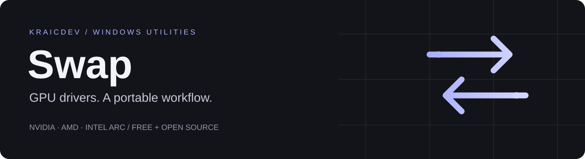
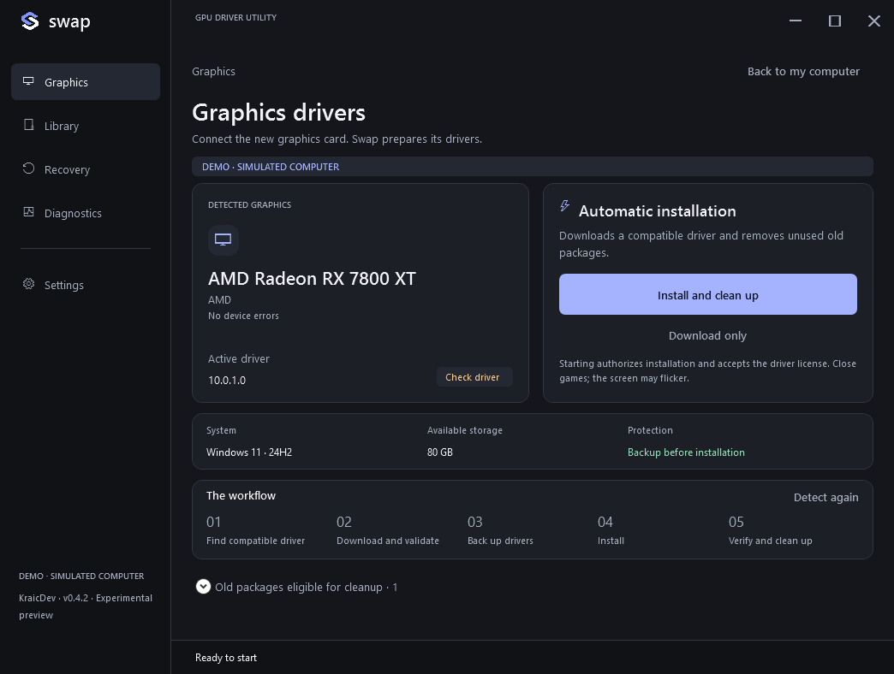
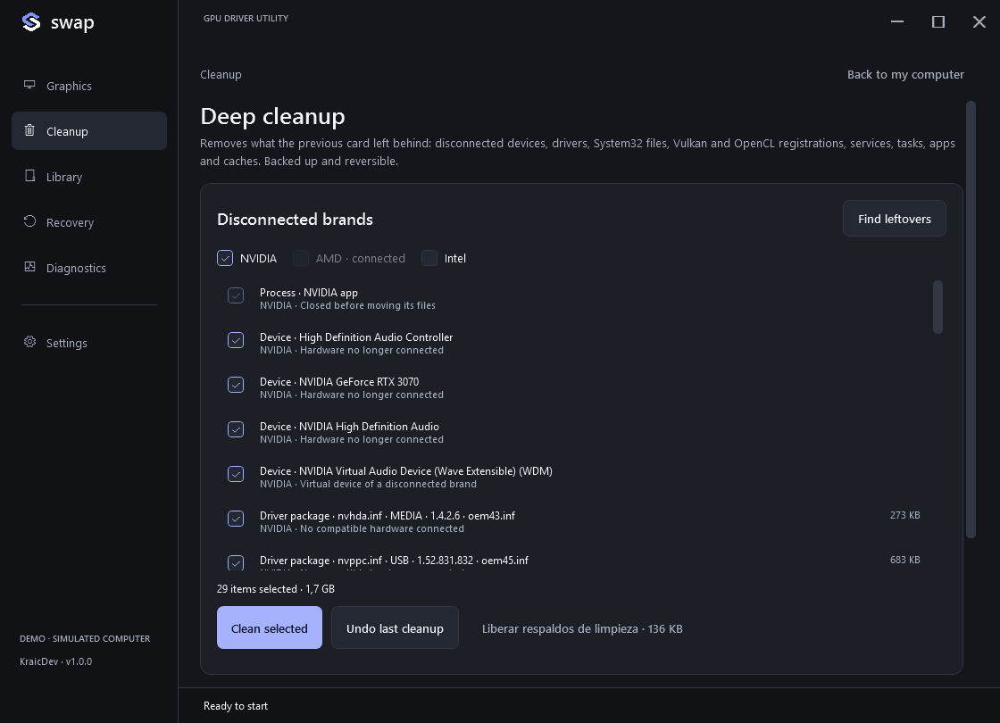

<p align="center"></p>

<p align="center"><a href="https://zkraic.github.io/Swap/">Website</a> · <a href="https://github.com/zKraic/Swap/releases">Download EXE</a> · <a href="README.es.md">Español</a> · <a href="CONTRIBUTING.md">Contribute</a></p>

**Prepare Windows after connecting a graphics card of another brand.** NVIDIA, AMD and Intel Arc. Installs the new driver, then removes what the old card left behind, with a backup and an undo button. Free, open source, no account or subscription.

> **Experimental preview · Windows 10/11 x64.** Driver installation has been tested with a simulated backend, not a physical GPU replacement. Deep cleanup and the disconnected-device fix were exercised on an isolated Windows 10 guest with real signed driver packages. Evaluate diagnostics and demo first. The executable is unsigned; trusted signing depends on external approval. [Validation](docs/validation/V050-RESULTS.md) · [Code signing policy](docs/SIGNING.md).



## Driver transition

With the new card connected, **Install and clean** finds a matching Display driver through Windows Update, downloads it, backs up existing graphics packages, installs it and verifies the active signed driver and hardware Direct3D. If several GPUs remain ambiguous, explicitly select the new card; Swap does not guess. Only then does it clean up the brand that is no longer connected. Present GPUs, integrated graphics and hybrid systems are preserved.

Windows keeps a removed card as a *disconnected device* that still owns its driver package, and refuses to delete that package. Swap removes only that disconnected entry of the same brand first, then the package. (Versions up to 0.4.2 stopped at this point on a real swap.)

## Deep cleanup



The **Cleanup** page does what people usually run Display Driver Uninstaller for, without Safe Mode, because the old card is already gone:

| Removed with evidence | Kept on purpose |
|---|---|
| Disconnected GPU, HDMI-audio and USB-C devices; vendor virtual devices | Anything of a brand that is still connected |
| Driver packages of every graphics class (Display, HDMI audio, USB-C, software components, extensions) | AMD chipset (VEN_1022), Intel network/storage/platform packages |
| Services, scheduled tasks and startup entries whose program is gone or being removed | PhysX (some games need it on any GPU) |
| Control panels from the Store, vendor folders (quarantined), shader caches, settings keys, orphaned Programs entries | The processor's integrated GPU and laptops: shown unselected |

Ownership comes from device instances and the hardware IDs in each driver's INF, not from product names. Every item shows why it qualifies and can be unselected. Before changing anything Swap creates a restore point, exports packages and registry data and moves folders to an integrity-sealed quarantine in `%ProgramData%\Swap\Cleanup` (Administrators and SYSTEM only). **Undo last cleanup** restores everything that has a backup; removed disconnected devices, Store apps and caches come back on their own when needed.

The same page can remove **older unused versions of the current driver** (often several GB), keeping the active one and the newest previous version for recovery.

| Graphics | Recovery | Diagnostics |
|---|---|---|
| Hardware-matched download and installation | **Independent graphics backup** with file integrity checks | GPU presence, PnP status and signed driver |
| Resume when Windows requires a restart | Signed INF library, compatible backup restore and cleanup undo | Hardware Direct3D, resolution, Hz and **PCIe lanes** |
| Stop on uncertainty; preserve present GPUs | Local history and support reports | **Highest refresh rate** with keep/revert, incidents, before/after |

After a swap Windows often runs the monitor at 60 Hz; Diagnostics offers the highest rate the display reports and reverts after 15 seconds unless you keep it. A card running with fewer PCIe lanes than it supports (wrong slot or not fully seated) is flagged. [Critical review of 0.5.0](docs/REVIEW-050.md).

## Download and open

1. Download the latest **Swap.exe** and its SHA-256 from [Releases](https://github.com/zKraic/Swap/releases).
2. Open it and accept Windows administrator permissions. No Swap installer, ZIP or separate .NET installation.
3. Review the detected card and choose an operation. Diagnostics need no reboot. Windows may require one after a driver change; Swap saves the session and preserves pending packages.

Automatic mode requires internet, a working Windows Update service, PowerShell 5.1 and at least 4 GB free plus driver space. It respects existing policies. Catalog drivers may be older than manufacturer releases. It does not automatically install the full Adrenalin/NVIDIA suite, PhysX or optional vendor applications. No forced package removal, Safe Mode boot changes or game tweaks.

Windows 7/8, x86 and ARM64 are not validated targets. Driver changes are blocked in Windows RDP sessions, while a known remote-control tool is running (including idle TeamViewer services), and during pending Windows servicing restarts. Diagnostics and independent backup remain available. Software inventory cannot certify GPU power or every game.

## Portable by default

The EXE includes its runtime. Local data is stored in `%LOCALAPPDATA%\Swap`; create a writable `Data` folder beside the EXE before opening it for removable-drive storage. Cleanup backups that could restore services or registry data stay in `%ProgramData%\Swap\Cleanup`. No permanent service or scheduled task. Driver operations requiring restart may temporarily register RunOnce and cache Swap for continuation; another UAC prompt may occur.

Six languages follow the PC language with English fallback: Spanish, English, Portuguese, French, German and Italian. Light/dark/system themes, keyboard navigation and high contrast.

```powershell
Swap.exe --demo       # Simulated hardware, including deep cleanup; no real changes
Swap.exe --readonly   # Native diagnostics; driver operations disabled
```

## Build and contribute

**C# · WPF · .NET 10.** Windows and the .NET 10 SDK:

```powershell
./scripts/Test.ps1
./scripts/Build.ps1
./dist/Swap.exe --demo
```

Build runs logic tests and creates the single EXE plus checksum. [Contribute](CONTRIBUTING.md) · [Architecture](docs/ARCHITECTURE.md) · [Testing](docs/TESTING.md) · [Recovery](docs/RECOVERY.md) · [Security](SECURITY.md).

## License and official releases

Copyright © 2026 **KraicDev** · [GPL-3.0-or-later](LICENSE). Distributed modifications must provide corresponding source under the GPL and retain required notices. Commercial reuse is allowed; impersonation or presenting a fork as official is not authorized by the [brand policy](TRADEMARKS.md). Official downloads remain free, without ads or subscriptions.

Official repository: **[zKraic/Swap](https://github.com/zKraic/Swap)**. NVIDIA, AMD, Intel and Microsoft do not sponsor or certify Swap. Their drivers are not bundled. Display Driver Uninstaller is an independent project and is not used or included. [Third-party notices](THIRD_PARTY_NOTICES.md) · [Privacy](docs/PRIVACY.md) · [Code signing policy](docs/SIGNING.md).

0.5.0 adds deep cleanup, fixes cleanup after a real card removal, and adds PCIe-lane and refresh-rate checks. [Changelog](CHANGELOG.md) · [Community and hardware results](docs/COMMUNITY.md) · [Recorded UI walkthrough](https://www.tiktok.com/@kraicdev/video/7695877540350594324).
